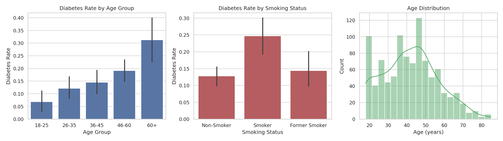
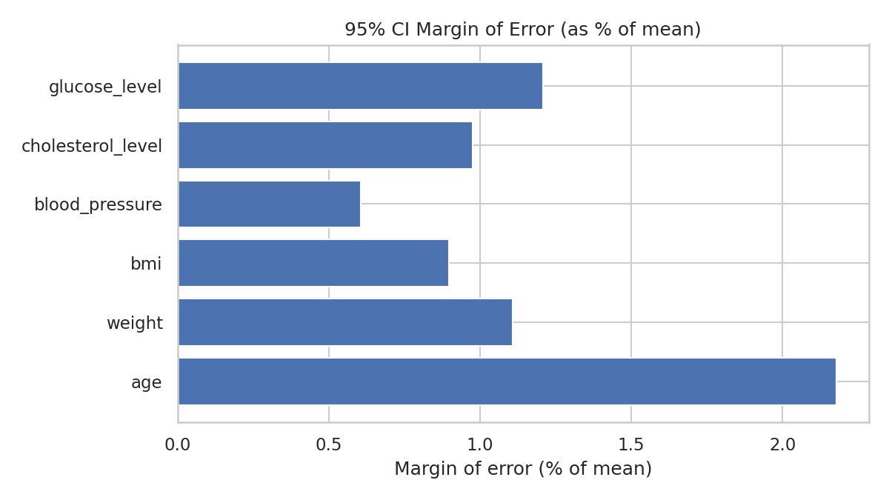
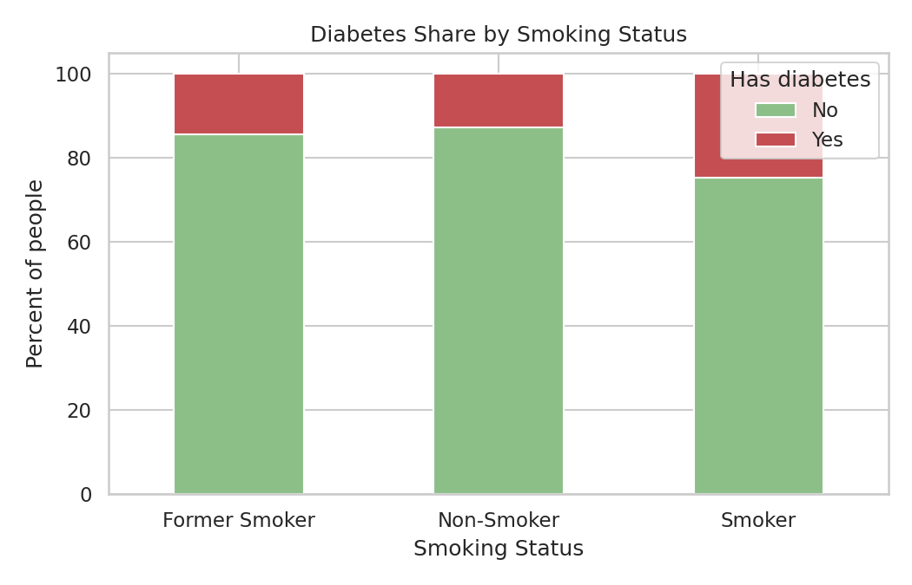
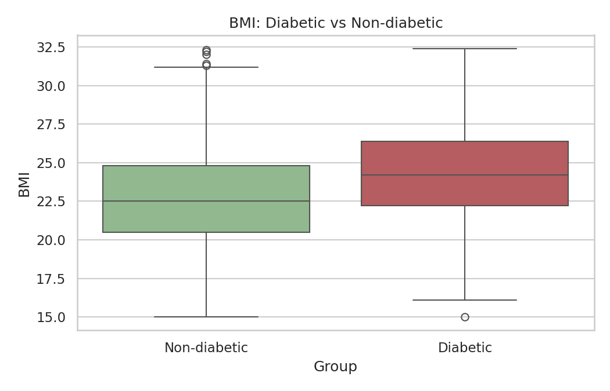
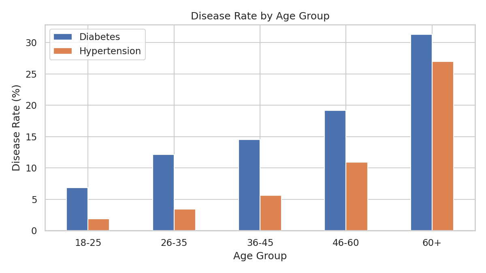
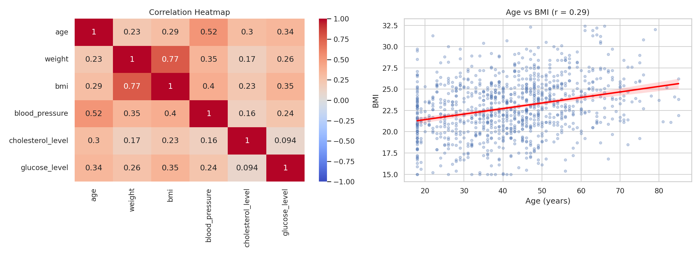

# Derivable Judgement: A Statistical Decision-Making Model

A beginner-friendly data science project. It uses **inferential statistics** to find which factors (age, smoking, BMI, gender) affect **diabetes** and **hypertension**.

> The dataset is **synthetic** (made by code). It is for learning only. It is not real patient data.

## What this project does
- Creates a health dataset of 1000 records.
- Writes short theory notes (PDF).
- Runs statistical tests in Python and explains each result in simple words.

## Project structure
```
.
├── Derivable_Judgement.ipynb   # Main notebook (code + results + interpretation)
├── generate_data.py            # Script that creates the dataset
├── Theory_Notes.pdf            # Theory concepts with definitions
├── README.md                   # This file
├── requirements.txt            # Python libraries needed
├── data/
│   ├── health_records.csv          # Main dataset (1000 rows, 15 columns)
│   ├── confidence_intervals.csv    # 95% CI results
│   ├── covariance_matrix.csv
│   ├── correlation_matrix.csv
│   └── results_summary.csv         # Summary of all tests
└── images/                     # Charts (PNG)
```

## Dataset columns
| Column | Meaning |
|---|---|
| record_id | Unique ID |
| age_group, age | Age group and age |
| weight, bmi | Weight and Body Mass Index |
| gender, region | Gender and region |
| smoking_status, exercise_frequency | Lifestyle habits |
| blood_pressure, cholesterol_level, glucose_level | Health measures |
| diabetes, hypertension | Disease (True / False) |
| visit_date | Check-up date |

## Tests done
| # | Question | Test | Result |
|---|---|---|---|
| 1 | Smoking vs Diabetes | Chi-square | Reject H0 (p = 7.75e-05) |
| 2 | BMI of diabetic vs non-diabetic | t-test and z-test | Reject H0 (p = 1.36e-08) |
| 3 | Gender vs Hypertension | Chi-square | Fail to reject H0 (p = 0.298) |
| 4 | Age groups vs Diabetes / Hypertension | ANOVA | Reject H0 |
| 5 | Age vs BMI | Covariance and Correlation | r = 0.29 (weak positive) |

Also done: 95% confidence intervals for age, weight, BMI, blood pressure, cholesterol and glucose.

## Key findings
1. Age is the strongest factor. Disease rate rises with age.
2. Smokers have a higher diabetes rate.
3. Diabetic people have a higher average BMI.
4. No clear link between gender and hypertension.

## Charts
| | |
|---|---|
|  |  |
|  |  |
|  |  |

## How to run
```bash
git clone <your-repo-url>
cd <repo-folder>
pip install -r requirements.txt
python generate_data.py            # optional: re-create the dataset
jupyter notebook Derivable_Judgement.ipynb
```

## Tools used
Python, Pandas, NumPy, SciPy, Statsmodels, Matplotlib, Seaborn, Jupyter Notebook.

## Limits
- Data is synthetic.
- Tests show a link, not a cause.
- The "Other" gender group is small, so its results are less reliable.
